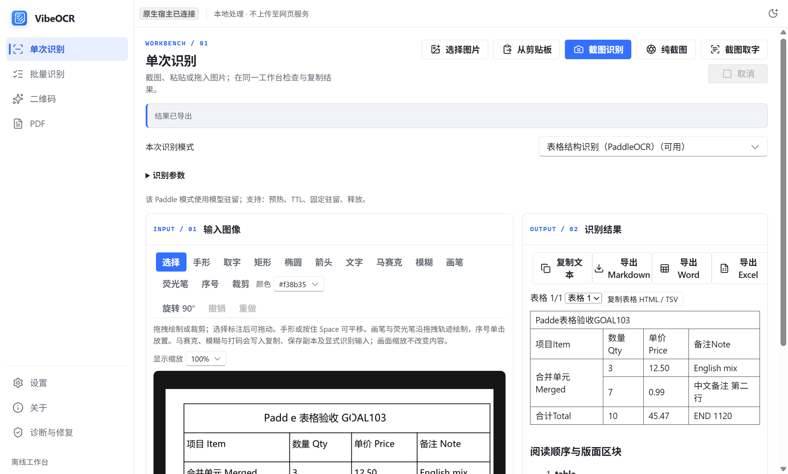
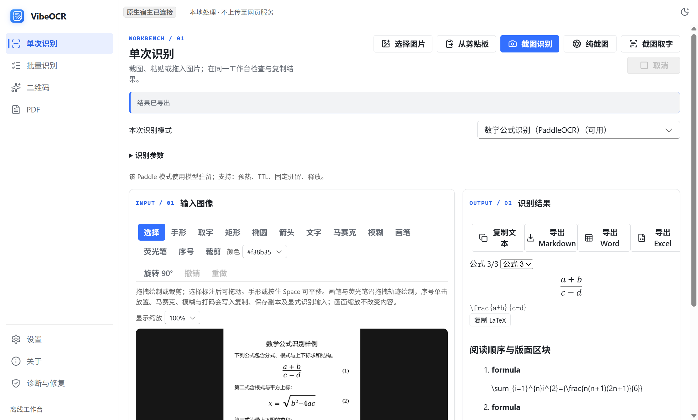
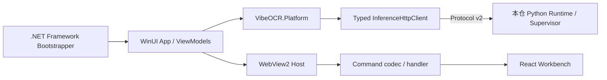

<div align="center">

# VibeOCR Next

**基于 .NET 10、WinUI 3 与 React 的现代 Windows OCR 桌面客户端**

[](https://github.com/FelixJI/vibeocr-next/actions/workflows/ci.yml)
[](https://github.com/FelixJI/vibeocr-next/releases/latest)
[](global.json)
[](src/dotnet/VibeOCR.App/WebAssets/package.json)
[](.ci/project.json)
[](LICENSE)

[下载](#下载与使用) · [架构](#架构) · [开发](#开发与验证) · [源码导读](docs/source-reading-guide.md) · [Workbench](docs/web-workbench-architecture.md)

</div>

VibeOCR Next 包含 WinUI 3 桌面客户端、Python Runtime 与跨进程内部契约。Platform 层管理窗口、
运行时与 typed HTTP client，WebView2 承载 React/TypeScript workbench。Supervisor、OCR/PDF
worker 仍在独立进程运行。

> [!IMPORTANT]
> Next 仅支持 Windows 10/11 x64，桌面技术栈是 WinUI 3，不是 WPF。Release 只发布由本仓当前
> 源码构建并绑定的单 Next 产品候选，不再消费独立 Backend/Protocol Release。
> 滚动截图需要 Windows 10 2004（build 19041）或更高版本，以排除控制窗及其阴影。

## 主要能力

- 原生 WinUI 3 桌面识别工作流；
- 随包 Runtime 定位、按需启动、ready 与 capability 协商；
- typed Protocol client 驱动的 job 提交、观察和控制；
- React/TypeScript WebAssets 与 WebView2 高级 workbench；
- 单实例、运行时前置检查和 Windows 打包交付。

## 下载与使用

1. 从 [Releases](https://github.com/FelixJI/vibeocr-next/releases/latest) 下载
   `VibeOCRNext-v<version>-win-x64.zip`。
2. （可选）校验完整性：同一次 Release 附带 `SHA256SUMS` 权威摘要。计算本地哈希并与其中
   对应文件条目的摘要比对（大小写不敏感）：

   ```powershell
   Get-FileHash .\VibeOCRNext-v*-win-x64.zip -Algorithm SHA256
   ```

3. 解压整个目录后运行根目录的 `VibeOCR.exe`；不要只复制 `current` 子目录。
4. 应用数据固定保存在解压根的 `state`；应用更新由 Velopack 在应用内检查、下载并应用。

桌面当前仍要求系统具备 .NET 10、Windows App Runtime 和 WebView2，启动器会检查这些前置条件。
完整依赖随包与干净系统验证见 [#321](https://github.com/FelixJI/vibeocr-next/issues/321)。

在“关于与诊断 → 更新”检查版本、下载并安装更新。更新由桌面宿主执行，
无需识别服务就绪；尚未检查时显示“尚未检查更新”，失败会显示原因。
“检测与下载来源”可选择官方直连，或填写自己的 URL 前缀／HTTP 代理，
页面展示当前检测地址和下载来源。保存来源后必须重新检查，检查和下载使用同一来源；
正在检查或下载时不能切换来源，可先取消当前操作。旧 `update.sources` 配置仍可读取，
未显式选择时使用其中首个有效项；显式选择后不跨来源自动回退。

“设置 → 应用”提供开机自启动与关闭时最小化到托盘开关。自启动状态从 Windows 启动项读取；
托盘开关默认关闭，启用后点击关闭按钮只隐藏主窗口到托盘，点击托盘图标可恢复原页面；
最小化按钮任何时候都只最小化到任务栏。未启用时关闭窗口执行退出确认；这两项设置不依赖识别服务启动。

### 识别服务与计算设备

解压完整产品包后即可打开主窗口、截图、编辑和使用本地二维码工具。首次 OCR、PDF 操作或在设置中点击“检查识别服务”时，桌面才启动随包解释器。并发请求共享同一次服务启动，每个请求可以独立取消。准备失败后可以用原输入重试。

在设置中选择自动、CPU 或 DirectML。服务用实际计算探测设备，再保存设置。识别任务或预热正在占用设备时，请在结束后重试。已提交任务使用提交时的设备与模型来源，后续任务使用新设置。CPU 和 DirectML 共用产品解释器和模型缓存。

Paddle 和 MinerU 可以分别选择模型来源。升级时读取旧配置中选中的设备、模型来源与缓存位置，保留原配置和用户文件。[旧设置与路径](docs/managed-environment-paths.md)

- 批量识别支持图片、PDF、Word（docx）、Excel（xlsx）和 PowerPoint（pptx）。PDF 可使用文字、表格及文档识别管道，并为每个文件单独填写页码（如 `1,3-5`，`r1` 表示最后一页）；留空时 PDF 沿用 MinerU 默认范围，其他管道默认全部。Office 文档使用 MinerU Flash 档整篇解析，按页识别需先转换为 PDF。
- MinerU 识别参数可在设置中选择服务声明的档位、OCR 模式和 PDF 默认页码范围；每个文件的页码可覆盖默认值。本地模式支持语言配置；远程语言由服务启动参数决定，客户端不能覆盖。MinerU 4 接口尚无公式/表格独立开关，界面会明确说明由档位与服务端控制。
- 自部署 MinerU 4 服务可在“设置 → MinerU 连接”切换为远程模式，填写服务根地址及可选
  API Key 后保存；远程模式无需安装本地 MinerU、模型或 GPU。只有当前 Backend 声明
  `ocr.mineru-remote-api.v1` 时才能配置远程模式。保存不会验证连通性，可点“验证并准备远程服务”
  让 Backend 执行准备并刷新能力目录，再在单次或批量识别中选择 MinerU 文档模式。
  API Key 留空保存会保留已存值，勾选清除项后保存才会删除。远程模式不受本地模型预热、
  进程空闲退出或释放控制，是否可解析以实际识别任务为准。
- “设置 → 空闲后释放资源”分别控制 PaddleOCR 和本地 MinerU，默认 600 秒（10 分钟），
  0 秒表示持久运行。计时从整个作业及必要清理完成后开始，排队/批次间隙、状态刷新不会触发或延长回收。
  到期退出自有 Worker，下次识别按需恢复；磁盘模型和环境保留。旧模型保留配置首次读取时备份为
  `supervisor-settings.json.worker-idle.bak` 后原子迁移，可在设置中恢复十分钟默认值。
### 模型准备与就绪状态

产品携带默认 small 文字检测、识别和文档方向模型。其他 Paddle ONNX 模型按固定清单从选定的 ModelScope 或 Hugging Face 准备，MinerU 使用自身模型机制。实际推理还取决于所选设备的驱动、模型文件及任务类型。
- 识别模式在对应任务中选择，各模式的可用性（可用/需准备依赖/不可用）以任务中的实际显示为准。

### Paddle 模式退役与旧设置

Paddle 仅保留文字、表格和非 VLM 文档结构识别，使用 CPU 或 DirectML 的 ONNX Runtime 环境（CUDA 执行分支已退役）；
模型提供 tiny、small（默认）、medium 三档。PaddleOCR-VL、独立 Paddle 公式和结构内专用公式/VLM 推理
已退役，这是本产品迁移范围，不表示 ONNX Runtime 不能运行任何 VLM 或公式模型。MinerU 能力继续保留。

现有模型、工程、识别结果和环境目录保留在原处。需要调整设备时请在设置中选择 CPU、DirectML 或自动。
保存的上述退役默认模式、截图固定模式或快捷键选择保留原值，执行时提示已退役，请重新选择；未设置默认使用 PaddleOCR 文字识别。
旧识别选项在读取副本中仅移除已知退役字段，保留方向等合法选项；读取不会写回配置，正常保存才原子写入。
如需恢复旧设置，可使用原配置备份和旧版本；历史公式、VL、表格结果仍可查看和导出，原始数据不批量重写。

RapidOCR 与 RapidTable 已退出当前产品的执行路径及发布依赖。已有 Rapid 文字／表格选择迁移到 Paddle 对应模式；
旧 Rapid 环境和模型不会自动删除，也不会被当作可用的 Paddle 环境。表格与文档结构识别继续使用 Paddle，
首次使用这些能力可能需要下载额外模型；历史任务结果保持可查看和导出。

### 识别类型与结构化结果

在单次、批量或 PDF 工作台选择本次识别模式，展开“识别参数”调整当前模式支持的选项并保存。
参数按模式保留；任务使用提交时的环境和参数，切换界面不会修改正在执行的任务。

- 表格结果提供单元格及合并预览、表格切换、HTML/TSV 复制和 Excel 导出。识别文本作为文本保存，
  不自动执行以 `=` 开头的内容。
- 公式结果提供多公式切换、离线渲染和原始 LaTeX 复制；渲染失败仍保留原文。
- 文档结果按阅读顺序展示区块及支持的图片、表格、公式；格式无法完整表达内容时，导出会提示限制。
  没有上游置信度的结果不显示虚构分数。





### 失败、取消与恢复

- 失败或取消会保留本次结果。按界面给出的原因与可用动作处理：“重新预览上次选择”重试、
  在“设置 → 运行环境 → 下载来源”调整包或模型来源后再预览，或在“诊断与修复”导出
  脱敏诊断；修改来源或组件选择后需要重新预览并确认。
- 安装失败记录保存在目标环境中，刷新或重启后仍可查看原因和恢复动作；旧健康修订保留。
  安装非活动环境不暂停当前服务；服务恢复不代表本次安装已成功。
- 依赖包下载源用于安装运行环境，模型下载源由引擎准备模型时使用，两者用途不同。请不要
  手工执行 pip、删除运行环境目录或下载缓存，也不要为安装问题更改显卡驱动。

## 架构



WinUI App 负责用户体验与进程生命周期，Platform 层隔离协议、系统和运行时能力；WebAssets 通过明确的
bridge command 与桌面交互，不直接访问 Runtime。Runtime 的 host 负责启动、鉴权和 HTTP 适配；
jobs 管理任务状态与调度；recognition 管理 OCR/MinerU 引擎和 worker；documents 管理 PDF 子进程、
表格与导出；codes 管理二维码；environments 管理安装、选择、设置与恢复；processes 托管共享的
Windows 子进程能力。跨进程 wire DTO、schema、golden 与生成物位于 `contracts/runtime`。

## 仓库地图

```text
src/dotnet/
├── VibeOCR.App/                    # WinUI 3 应用
│   └── WebAssets/                  # React 19 / TypeScript / Vite workbench
├── VibeOCR.Platform/               # Protocol、进程与平台 seam
├── VibeOCR.Contracts/              # 内部 C# wire 契约源码
├── VibeOCR.Runtime.Client/         # 内部 C# loopback HTTP client 源码
├── VibeOCR.ProductLayout.Shared/   # 产品布局共享源码（编译进 Platform）
└── ...Bootstrapper.../             # .NET Framework 4.7.2 启动器
src/runtime/vibeocr/runtime/       # Python Runtime，内部按功能分组
contracts/runtime/python/          # Python wire 契约、schema 与生成物
tests/dotnet/
├── VibeOCR.Platform.Tests/         # 平台与 Protocol 测试
├── VibeOCR.App.Tests/              # WinUI app tests
├── VibeOCR.Contracts.Tests/        # 内部 C# wire 契约测试
└── VibeOCR.Runtime.Client.Tests/   # 内部 C# HTTP client 测试
tests/runtime/ 与 tests/python/     # Runtime、产品布局与契约行为测试
config/runtime/                     # 第三方 CPython 归档锁与运行环境 profile 锁
scripts/
├── check_quality.py                # Python/Node 质量入口
├── generate_runtime_protocol.py    # 从内部 schema 生成 Python/C# wire 绑定
├── install_windows_app_runtime.ps1 # 开发/CI 前置条件
├── build-release.ps1               # 单产品候选构建入口
├── build_internal_runtime.ps1      # 从当前源码构建内部 Runtime 发布闭包
└── automation.py                   # CI/发布稳定入口
docs/                               # 架构、截图与源码阅读文档
.ci/project.json                    # 构建、测试、资产与发布契约
```

#87 起桌面构建直接消费本仓源码：C# 侧通过 ProjectReference 编译 `VibeOCR.Contracts` 与
`VibeOCR.Runtime.Client`，不再引用独立 Protocol SDK NuGet 包，默认也不解析、下载旧
`vibeocr-backend`/`vibeocr-protocol` Release。Python 侧构建为单个内部 wheel
`vibeocr-next-runtime`，版本由 `repository.json` 派生，作为运行环境隔离安装的实现细节随产品
分发，不再有独立 Python 契约发行面。内部只保留一个 wire v2 契约，随本仓同源演进；跨仓
SDK/Backend/Protocol minor 产品矩阵退役，但 capability 协商、进程隔离、已安装运行环境的
manifest 绑定与回滚语义保留。

Runtime 源自 `FelixJI/vibeocr-backend@7dc0ddf446152ef854901760d5125ad64860975b`；
wire/C# 契约源自 `FelixJI/vibeocr-protocol@31609e19bee1d44562eb74aff2d74fc75bb93eda`。
二者与本仓同为 MIT，作者版权见根 `LICENSE`；两源仓及 `vibeocr-classic` 已归档为只读历史，
本仓的开发、构建与发布不依赖它们的未来提交或发版。仅旧 Python UI 使用的
`frontend.py`、无 Runtime/Next 入口的 application facades、`model_bridge`/`ocr_sidecar`、
完整 Python runtime_client SDK、独立 SDK 发版/治理脚本未迁入。保留了直接消费的 C#
`RuntimeHttpClient`/`RuntimeClientException`、PDF IPC schema、wire parser 与安装计划行为测试；
仅旧 Python 客户端发行面的测试和只测试旧仓 CI/CD 配置的用例没有作为产品接口继续维护。

## 两条核心链路

### 应用启动

`App.xaml.cs::OnLaunched` 依次处理单实例、前置条件、窗口创建与 Supervisor 生命周期；
`InferenceSupervisorProcess` 读取 ready envelope 和 capabilities，再把可用 client 交给应用层。

### 提交识别

`RecognitionViewModel` 通过 deferred/typed client 调用 Platform 的 `InferenceHttpClient`，由后者按
Protocol v2 与 Backend 通信。ViewModel 不应拼 HTTP 或依赖模型内部类型。

完整路线见 [源码阅读指南](docs/source-reading-guide.md)。Web workbench 的 bridge 设计见
[`docs/web-workbench-architecture.md`](docs/web-workbench-architecture.md)。

2026-09-07 的历史审阅与验证记录：[可维护性审阅](docs/maintainability-readiness-audit.md)、
[窗口布局验证](docs/e2e-layout-validation.md)。当前验证状态以对应 PR 为准。

## 开发与验证

需要 Windows、仓库锁定的 [.NET SDK](global.json)、[uv](https://docs.astral.sh/uv/) 与 WebAssets
声明的 Node/npm 版本：

```powershell
git clone https://github.com/FelixJI/vibeocr-next.git
cd vibeocr-next
uv sync --frozen
npm ci --prefix src/dotnet/VibeOCR.App/WebAssets
$env:RUNNER_TEMP = (New-Item -ItemType Directory -Force build/runner-temp).FullName
pwsh -File scripts/install_windows_app_runtime.ps1
dotnet tool restore
dotnet restore tests/dotnet/VibeOCR.Platform.Tests/VibeOCR.Platform.Tests.csproj --locked-mode
dotnet restore tests/dotnet/VibeOCR.App.Tests/VibeOCR.App.Tests.csproj --locked-mode
dotnet restore tests/dotnet/VibeOCR.Contracts.Tests/VibeOCR.Contracts.Tests.csproj --locked-mode
dotnet restore tests/dotnet/VibeOCR.Runtime.Client.Tests/VibeOCR.Runtime.Client.Tests.csproj --locked-mode
uv run --frozen python scripts/check_quality.py
dotnet test --project tests/dotnet/VibeOCR.Platform.Tests/VibeOCR.Platform.Tests.csproj -c Release --no-restore
pwsh -File scripts/test_app_ci.ps1
dotnet test --project tests/dotnet/VibeOCR.Contracts.Tests/VibeOCR.Contracts.Tests.csproj -c Release --no-restore
dotnet test --project tests/dotnet/VibeOCR.Runtime.Client.Tests/VibeOCR.Runtime.Client.Tests.csproj -c Release --no-restore
```

这些命令与 [`.ci/project.json`](.ci/project.json) 对齐。完整 PR CI 还会执行 release build、smoke、
产品 identity 与正式资产检查。

## WebAssets

WebAssets 的 Node/npm 版本以 `.node-version` 与 WebAssets `package.json` 的
`engines`/`packageManager` 为准，React、TypeScript、Vite 等依赖版本以 `package-lock.json`
锁定为准，不在本文重复维护。修改后至少运行其 package scripts 中的 lint、typecheck、test 与
build。WebView2 bridge 变更必须同步更新桌面 handler/codec、前端 client 与两侧测试。

## 发布资产

发布 PR 只能在 `main` 上手动运行 CD、选择原有 bump 类型来创建或刷新。
`main` 前进后，不使用 GitHub 的更新分支或合并 `main` 来同步 `automation/release`；
必须重新运行同一准备流程，重新生成版本、changelog 和 `.release/plan.json`。
CI 通过 `scripts/automation.py ci` 的声明式 bootstrap 校验计划的 `prepared_from_sha`
与本次合并基线，不匹配时在安装依赖前失败；workflow 不另设发布校验入口。


正式 Release 精确包含 Velopack full nupkg、相邻版本可选 delta nupkg、Portable
（`VibeOCRNext-v{version}-win-x64.zip`）、feed（`releases.win.json`）、`product-identity.json`
和 SPDX SBOM，不再单独发布独立组件锁文件。`scripts/build-release.ps1` 调用
`scripts/build_internal_runtime.ps1` 从当前源码构建内部 wheel，按 `config/runtime/` 的 CPython 归档和锁将其装入随包 Runtime 树。Runtime manifest 绑定解释器树清单、依赖锁与默认模型包。产品内部沿用 `runtime/backend/` 与
`app/metadata/component-lock.json`、`app/metadata/component-identities.json` 作为兼容稳定路径，
不是旧仓产品图：`component-identities.json` 与 Release 外部 `product-identity.json` 同为
`project:{component,repository,version,source_sha}`；`runtime-manifest.json` 的 `product`
同样只含这四字段，预构建树清单绑定、profile 与 capabilities 位于 manifest 顶层；
`component-lock.json` 的 `product` 在四字段之上追加 `runtime_manifest_sha256` 与
`accelerator`，`required_capabilities` 位于 lock 顶层。版本与派生文件只由自动化脚本更新。

### 消费面迁移对照（旧多仓组件 → 单产品）

- 独立 NuGet SDK：之前编译期从本地 feed 按 `Directory.Packages.props` 精确 pin
  `VibeOCR.Runtime.*`；现在 C# 直接 ProjectReference 本仓 `VibeOCR.Contracts`/
  `VibeOCR.Runtime.Client` 源码，NuGet 源只剩 nuget.org，不再存在独立 Protocol SDK 包。
- Python 契约发行：之前跨仓存在独立契约/SDK 发版面；现在只构建单个内部 wheel
  `vibeocr-next-runtime`（版本由 `repository.json` 派生），作为运行环境隔离安装的实现细节随
  产品分发，不对外独立发行。
- 跨仓 resolve/bind：之前 bootstrap 解析最新正式 Backend Release 及其绑定的 Protocol 并写
  组件 identity；现在默认不解析任何旧仓 Release，候选绑定由 Release 外部 `product-identity.json`
  （`project` 字段）与产品内 runtime manifest、component lock（`product` 字段）完成。
- Protocol 发行字段：之前候选 identity 含 `protocol`/`protocol_sdk` 版本与 release manifest
  摘要；现在 Release 外部 `product-identity.json` 只含
  `project:{component,repository,version,source_sha}`；`product` 字段只出现在产品内
  `runtime-manifest.json`（同四字段）与 `app/metadata/component-lock.json`（追加
  `runtime_manifest_sha256`/`accelerator`，`required_capabilities` 在 lock 顶层）。
- 外部 hash 边界：第三方 CPython 归档、offline pack 等外部下载字节仍保留 SHA-256 校验与
  manifest 绑定；本仓生成物交给 Git/构建/发布流水线约束，不叠加手工 hash。

## 参与贡献

请先阅读 [`CONTRIBUTING.md`](CONTRIBUTING.md)、[源码阅读指南](docs/source-reading-guide.md) 和
[Workbench 架构](docs/web-workbench-architecture.md)。提交使用 Conventional Commit。

## 许可证

本项目基于 [LICENSE](LICENSE) 中的条款发布。
