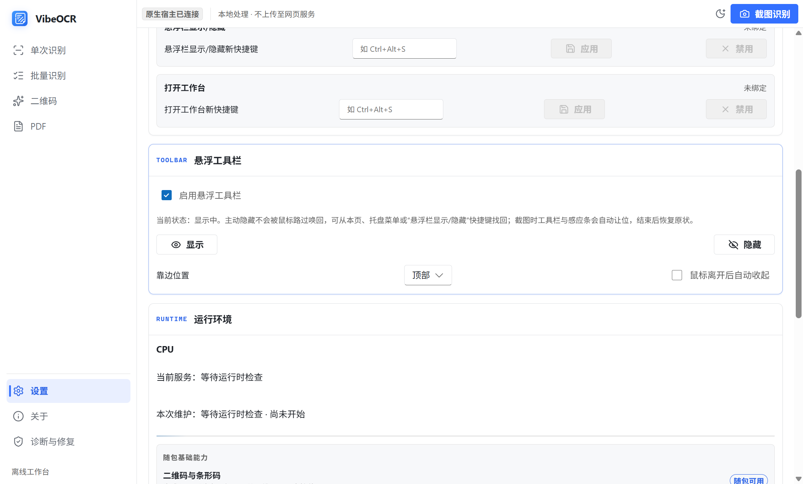
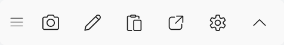
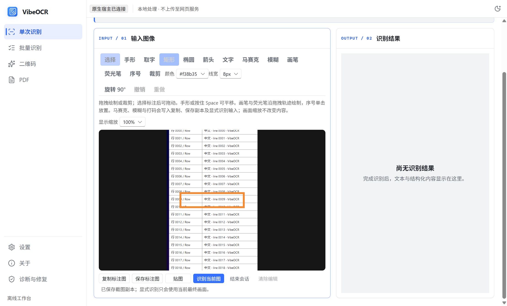
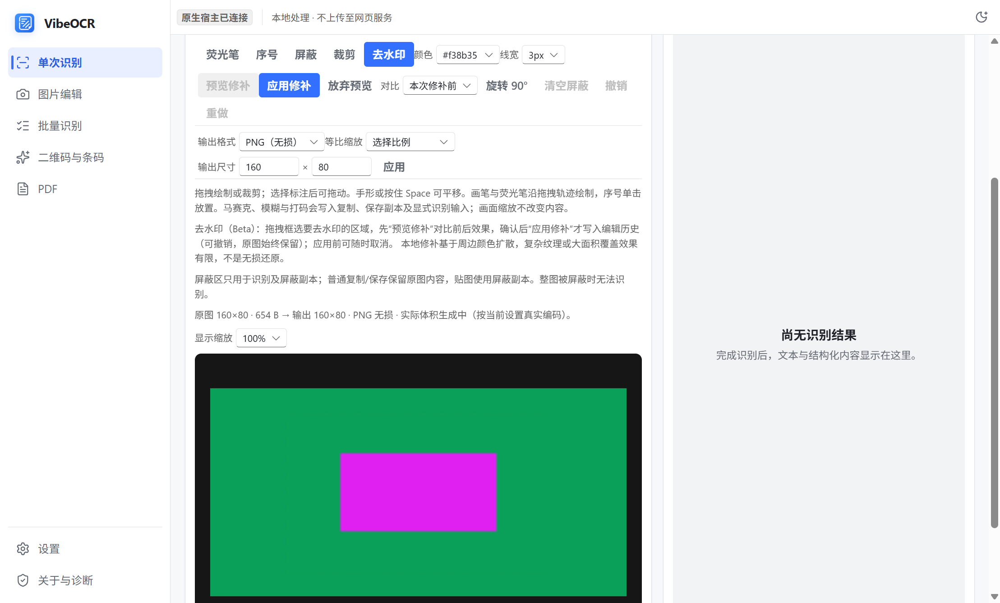
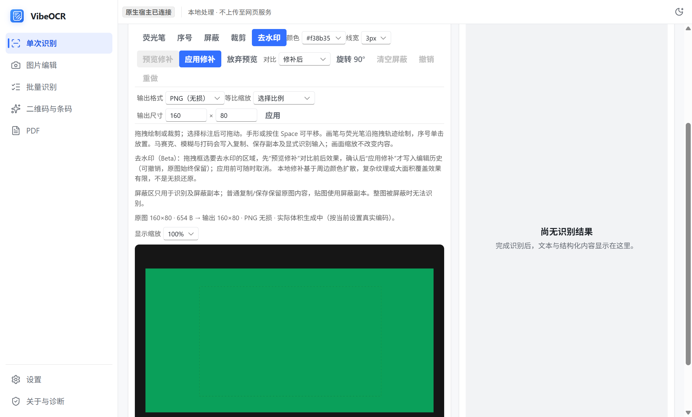
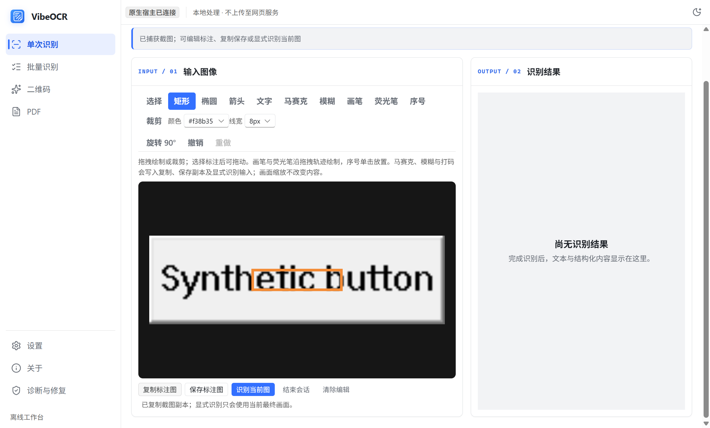
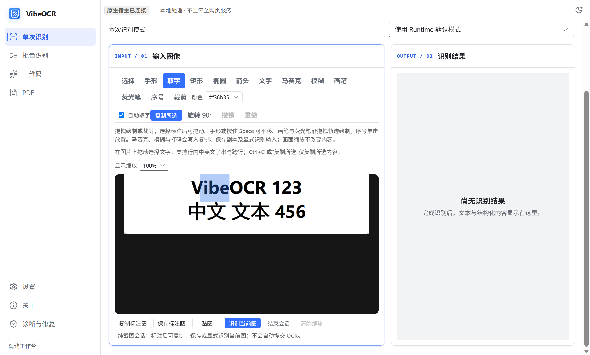

# 截图与原生快捷动作

设置页可配置截图编辑、截图识别、剪贴板识别、悬浮栏显示/隐藏和打开工作台五种动作。截图识别默认使用 `Ctrl+Alt+Q`；其他动作默认不占用全局快捷键。注册冲突或配置保存失败时保留原生效绑定，并显示失败原因。

悬浮工具栏支持启用、主动隐藏、靠边位置、收起延迟和收起后露出像素（1–20 像素）。感应条只位于工具栏停靠位置，鼠标离开后自动收起；全屏应用前台期间感应条让位，退出全屏后恢复。主动隐藏不会被鼠标经过唤回，可从设置、托盘或已绑定的快捷键恢复。截图期间主窗口、工具栏和感应条自动让位，结束或取消后恢复原状态；重复截图动作不会创建第二个选区窗。

收起时长可设为 100–5000 毫秒，仅在自动收起开启时生效；新配置默认 300 毫秒，已有保存值保留。指针重新进入会取消本次收起，下一次离开重新计时。主题可跟随系统、固定亮色或固定深色；高对比使用系统配色。

## 框选与确认

- 悬停外部窗口提供窗口候选，`Tab` 切换可用窗口、控件与父级候选。UIA 超时或不可用时仍可手动框选。
- 拖动创建选区，松开左键后进入待确认状态；在选区内拖动可移动，在边缘或控制点处拖动可调整大小。
- `Enter` 确认原始冻结快照中的选区。截图编辑保留当前冻结桌面，在原选区位置显示画布和浮动编辑工具，不弹出主界面；截图识别按当前识别设置提交。取消新的框选会保留此前的图片编辑会话。
- 右键在拖动中恢复拖动前的状态，待确认时清空选区，空选区时退出；`Esc` 始终退出截图。
- 撤销和重做只影响选区操作，不撤销已提交的识别任务。

| 按键 | 操作 |
| --- | --- |
| Enter | 确认选区 |
| Tab | 切换智能候选 |
| Esc | 退出截图 |
| 方向键 | 移动选区 1 个物理像素 |
| Shift + 方向键 | 移动选区 10 个物理像素 |
| Ctrl + 方向键 | 调整选区右边缘／下边缘 1 个物理像素 |
| Ctrl + Shift + 方向键 | 调整选区右边缘／下边缘 10 个物理像素 |
| Ctrl + Z | 撤销 |
| Ctrl + Y / Ctrl + Shift + Z | 重做 |
| M | 显示／隐藏放大镜 |
| Ctrl + C | 复制当前取样像素的 HEX 色号 |

放大镜展示鼠标周围 11 × 11 个原始像素，中心红框对应色号；同时显示桌面坐标、HEX 和 RGB。取色来自冻结快照，不受遮罩及选框颜色影响。

## 滚动长截图

在工作台点击“截图”，框选同一个窗口的内容区域，再在选区动作栏选择“长截图”；长截图直接复用当前选区。选择向下、向上、向右或向左，默认手动滚动；也可勾选“自动滚动”。开始后先检查首帧预览，明确确认后才滚动。每次保留至少四分之一画面（且不少于 32 像素）的重叠，停稳等待计数更新。点击“完成”后会重新采样最后一帧，再展示整个已收选段；确认方向和接缝后，点击“确认选段并送入编辑器”，继续标注、复制、保存、选字或主动识别。完成仅表示用户确认的捕获范围，不保证整个文档已到末尾。

选区宽高均须至少 32 像素，所选滚动方向的轴长须至少 64 像素。固定标题栏或页脚应优先避开；需要包含时，可显式填写顶部/左侧与底部/右侧的固定像素范围，至少留下 64 像素可滚动内容。首帧确认时核对范围，输出两端各保留一次。仅这些用户指定的边缘会参与固定栏处理，且每帧必须完全一致；范围内内容变化会停止，不会静默删除变化内容。

自动模式会短暂把光标定位到选区中心，通过系统输入向所属的普通桌面窗口发送有界标准滚轮；支持方向由目标控件决定。每次发送后仅在光标仍位于程序定位点时恢复原位，不覆盖用户的光标移动。请松开鼠键及 Ctrl/Shift/Alt，按键未松开或系统拒绝输入时会停止。不支持游戏、受保护画面、提权窗口和不接收标准滚轮的自定义控件。连续三次没有前进时暂停，明确提示无法判断是否到达末尾；确认后可手动继续，或预览并确认当前选段。没有新增内容 30 秒（含控制窗交互和纠偏等待）或采集总计 3 分钟（含预览等待）即停止，不会无限滚动。

反向输入会暂停自动滚动，该帧不加入选段，也不要求输入正向纠偏位移。点击“丢弃反向帧并继续”后，可按所选方向滚回已收边界再前进，或完成并预览已有选段；返回边界前的反向画面不会重复弹出同一提示，也不会重置无进展期限。仅负向的多种匹配同样按反向输入处理。没有可靠重叠时，所有支持位移均已检查过，会明确停止，请取消后减少滚动量重试，不提供必败的位移纠偏。重复图案存在至少一个符合资源上限的正向匹配时，才会暂停自动滚动并保留已收预览和待拼帧供核对；正向匹配全部超限时直接停止。可以输入所选方向的真实位移，再明确“确认位移并校验拼接”；位移须在可用重叠范围内，全部重叠像素必须一致，纠偏不会绕过固定栏、帧数或像素限制。无法确认时请取消重新框选；动画、纹理不足、源窗口关闭/移动/缩放、遮挡、切换其他应用或显示器布局变化也会停止。控制窗口必须完全在选区外，没有空间时请缩小选区。

成品最多 800 万像素、单边 32768 像素及 200 个有效画面，重复画面不计数。内存按这些固定上限保留首帧、上一帧和新增条带，预览与最终合成也受同一像素上限约束。失败后保留最初原因，后续超时或并发错误不会覆盖；采集、匹配及预览工作随失败停止。取消、失败或超限丢弃本次拼接，不把不完整图片冒充成品；取消或关闭控制窗会释放捕获资源并恢复宿主。捕获本身不提交 OCR，也不安装模型。普通截图与长截图均不更改 Windows 任务栏的自动隐藏偏好。
## 编辑与输出

工具与操作统一放在上排，下排只显示当前工具或选中标记的属性。图标以加粗的 Tabler Outline 为主，重新框选、手形平移及马赛克使用 IconPark；模糊使用柔化边缘的效果图形。马赛克和模糊保留短标签。

矩形与椭圆支持独立的边框颜色、不透明度，以及填充开关、颜色和不透明度。不透明度可输入 0–100 的整数百分比：0% 完全透明，100% 完全不透明。使用选择工具选中已有标注后，可在属性排修改样式并撤销、重做；默认不填充，旧标注保持原效果。

选择工具支持单击选择、Shift/Ctrl 单击增减选择，以及从空白处拖框完整包含对象。画布获得焦点后，Ctrl+A 全选未锁定对象，Ctrl+C/Ctrl+V 在编辑器内复制粘贴对象，Ctrl+D 创建偏移副本，方向键微移 1 个逻辑像素、Shift+方向键微移 10 个，Delete 删除；批量操作可一次撤销，副本样式与原件独立。输入框与输入法组合期间保留原生文字快捷键。

上排文字动作提供置顶/置底、逐层移动、按对象边界对齐和至少三个单元的中心等距分布（首尾固定），以及组合/解组、锁定/解锁、90° 旋转、等比缩放和水平/垂直镜像。组合保持成员相对位置与绘制层级；对象自身旋转/镜像会变换字形，整图旋转仍保持文字正立。透明对象按几何选择；锁定对象跳过画布命中且禁止修改，可从下排“选择标注对象”列表选中后解锁。完全离开画布的对象保留在列表，显式“回中心”可整体移回并撤销。对象剪贴板只属于当前图片编辑会话，不写入系统剪贴板。

截图编辑支持裁剪、旋转、标注、马赛克和模糊；独立图片编辑与截图会话共用同一套工具。马赛克与模糊可用矩形或自由笔刷绘制，笔刷大小可选，强度在 1.0–3.0 间以 0.1 连续调整，兼容原弱/中/强档位；选中已有区域后可再调强度。对象缩放同步笔刷宽度，效果随旋转、裁剪进入真实导出像素，笔刷效果保留原图透明度。“遮挡”将所选纯色写成不透明像素，与仅用于识别的“屏蔽”区域分开。复制图片、保存副本和显式识别均使用当前最终画面；纯截图编辑不触发 OCR 或安装运行环境。

去水印（Beta）支持矩形和笔刷增减掩膜，可保留孔洞；先预览并对照原图，明确“应用修补”才写入可撤销的编辑历史，放弃预览保留原画面。掩膜外及孔洞内像素保持不变，复杂纹理或大面积覆盖效果有限，不承诺恢复真实原内容。处理完全在本地执行，不依赖 OCR 环境、GPU 或网络；整图上限 8MP，掩膜包围盒及有效掩膜各不超过 1MP，计算受工作量预算约束。历史中不同补丁合计最多 8MP，同一补丁的多个历史引用只计一次；撤销仍保留重做，新提交才释放被截断分支独有的补丁。超限明确拒绝新应用，保留旧撤销历史。

“重复匹配”在原图与已应用补丁上查找同尺度整数平移副本，支持最多 8MP 的图片和最多 262144 像素的源块；低纹理或搜索超出工作量预算时明确提示失败。去除重叠前最多保留 4096 个合格窗口，超过上限明确失败；完整扫描后按误差升序去除重叠，同误差按从上到下、从左到右排序，最终候选最多 8 处，可逐项勾选或放弃，确认前不改变导出内容；确认后以周边环境色生成不透明遮挡，一次撤销可恢复整批。遮挡随整图旋转、裁剪进入复制及保存的真实像素。

完成画面提供“文字识别”“表格识别”“公式识别”三个文字按钮。文字识别使用设置中已提交的默认文字／文档引擎，表格与公式使用当前运行环境目录声明的对应模式；未就绪的按钮禁用并解释原因，可到设置中检查运行环境与默认识别类型。点击时冻结当前编辑后的图片、识别模式与选项，等待准备期间更改任务模式不会改变这次提交，也不会静默换成其他模式。结果的选字、原图行框校对、复制和导出沿用该次输入与结果；识别承载面取消、换图或修改对应输入后，旧结果失效；独立图片编辑继续编辑不会改变已经交接的识别快照。翻译目前未启用，不发送图片或文本到外部翻译服务。

合成样例的修补前后如下；预览成功后仍需点击“应用修补”，才会改变后续复制、保存及识别输入。

“屏蔽”工具拖拽框选识别排除区，可多选、拖动、八点缩放、删除、清空并撤销/重做，单图最多 64 个（与贴图排除矩形上报上限一致）。排除区只从识别输入与显式屏蔽副本中移除内容：提交识别前会在屏蔽区写入不透明白色像素（原图文字不进入引擎），普通复制/保存仍保留原图内容；也可用“复制/保存屏蔽副本”显式导出真实白色覆盖的成品。桌面贴图是可取字的识别面，同样使用与识别相同的屏蔽像素，其可选行与编辑器一致地丢弃与屏蔽区相交的行。原图始终保留，屏蔽不是永久脱敏。整图都被屏蔽（含贴图）时会拒绝识别并提示。坐标随裁剪、旋转与输出尺寸变换，视图缩放不影响数据；掩膜矩形在像素网格上确定性外扩取整（每边至多 1px），保证屏蔽区边缘不残留原始文字像素；屏蔽区变更会推进内容修订，旧识别结果与文字层立即失效。

以上截图由真实 WinUI/WebView2 验收生成，图像内容为合成控件。

## 可编辑工程

在图片编辑中使用“保存工程”保存 `.vibp` 文件，再通过“打开工程”恢复并继续编辑。工程包含原图、图片对象、标注及样式、裁剪旋转、输出尺寸和已应用的修补；PNG/JPEG 保存仍输出合成后的图片。截图现场也可保存工程，重开后进入普通图片编辑，不恢复桌面窗口或截图选区身份。

工程不保存撤销/重做记录、未提交草稿和修补预览；重开后的内容是新的编辑起点。打开时先检查并准备全部资源，成功后才替换当前画布；取消、超时、损坏或不支持的格式版本会明确拒绝并保留旧工作。保存由原生文件选择器选择位置并原子替换目标文件，原图不会被工程内容覆盖。

## 图片选字与桌面贴图

截图取字在当前图片上异步准备文字层；也可从编辑器进入选字模式。使用已就绪的本地轻量引擎，没有本地能力时提示准备，不自动安装或切换到远程识别。手形用于平移，选字模式用于拖选，标注工具用于修改图片。

可拖选中文、英文行内子串及跨行文本，通过 Ctrl+C 或菜单复制所选内容。当前快速引擎提供行框，文字层利用浏览器字形排版贴合行框，字符对齐是近似值，不是逐字符识别坐标。编辑、裁剪、旋转或打码使当前旧文字层立即失效；重新取字使用修改后的最终像素。

桌面贴图可置顶、移动、缩放、调节透明度、复制、保存与关闭，最多同时四张。显示缩放不重新识别；不同贴图各自保留冻结图片，关闭其中一个不会回收另一个的图片。原截图换图后，旧贴图明确标为旧快照，可主动按其原图取字，不会覆盖新截图结果。纯截图编辑与纯贴图不触发 OCR 或环境安装。

