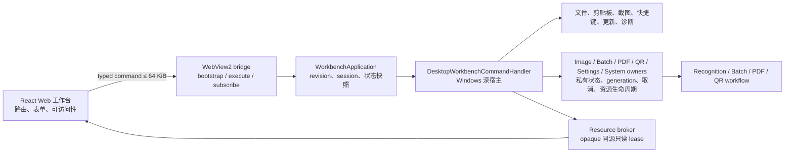
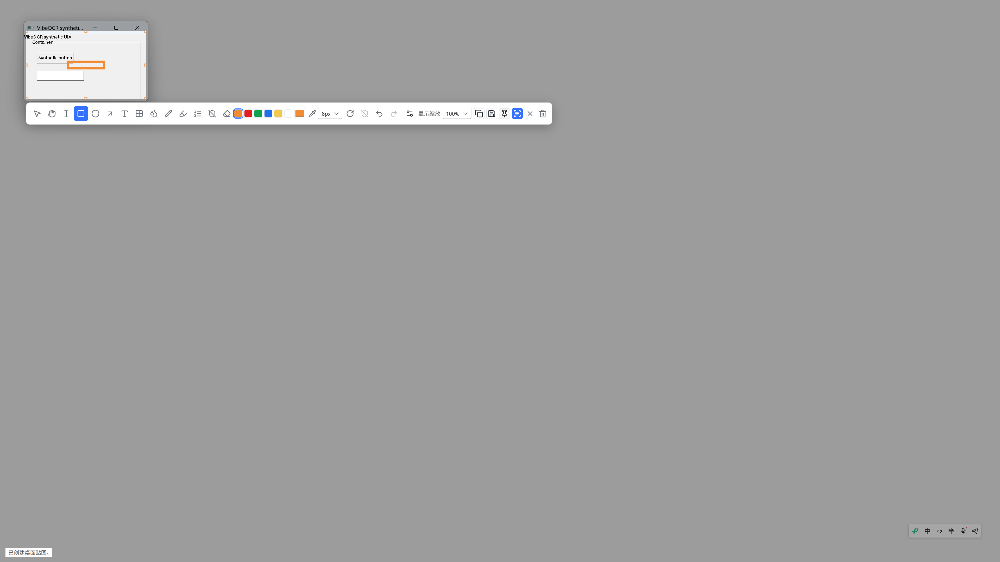

# Web 工作台 + 原生深宿主

## 目标

VibeOCR Next 的可见主界面由 React/TypeScript/Fluent UI 统一呈现；Windows 平台能力、任务生命周期、Backend 治理、文件与剪贴板访问、更新和诊断仍由 C# 原生宿主管理。Web 不直接访问 Backend、本地文件路径或外网。

## 模块边界

`WorkbenchApplication` 是稳定 interface。Web 只发送白名单命令并订阅语义状态；C# 拥有 route、任务、持久设置、资源租约与恢复状态。焦点、hover、菜单、未提交表单草稿等纯展示状态归 Web。

Desktop facade 只组合依赖、分派到功能 owner 并统一映射错误；owner 不持有整个 facade。资源授权和模式选择分别由
`WorkbenchResourcesOwner`、`WorkbenchSelectionOwner` 共享，`WorkbenchOperations` 只拥有应用 lifetime、发布和后台操作追踪。
前端按 feature 使用 React lazy，`Pages.tsx` 是兼容导出；纯图片编辑入口只拉取自身生产闭包，不加载 PDF、环境设置、批处理和公式模块。

图像编辑预览由 `ImageCanvasEditor` 按动画帧合并绘制最新草稿；换图、换会话和卸载取消旧帧与拖拽。已提交文档仍是撤销、重做和全尺寸导出的共同来源；交互绘制不编码、不传输整图，只有明确输出或按需检查才编码。

## 协议不变量

- bridge protocol 与 Desktop↔Runtime 内部 HTTP wire（`contracts/runtime` 的唯一 v2 契约）
  独立版本化，编号相同不代表同一协议。
- 每条消息按 UTF-8 计算不超过 64 KiB。
- 命令是封闭 discriminated union；未知字段、未知 action、错误类型和超限消息 fail closed。
- `revision` 全局单调；旧 session 或旧 revision 的事件被 Web 忽略。
- 图片、二维码、PDF 预览和长文本通过 `https://app.vibeocr/__resource/{opaque-token}` 获取，不进入 JSON，也不暴露本地路径。
- 副作用命令在 WebView 恢复后不自动重放。

每个订阅按 scope 保存最多一个最新槽和一个受保护完成槽，信号 channel 容量一，每个宿主最多一个实际 dispatcher callback。
main 订阅十个 scope；scene 只订阅 shell、recognition、仅 theme 的 settings，不接 PDF、batch、环境列表和安装日志。
历史缺口或多个完成事件合并后，reset→每 scope replace→ready 在同 checkpoint 原子提交当前权威状态，缓冲不超过投影 scope 数。
普通消息仍严格递增 revision。当前错误/完成真值由实际 ViewModel/Workspace 保留到对应新操作或关闭，不由整个 scope 门冻结其他操作。
receipt/error response 与 PDF preview flush 走独立关联通道；reset 完成仍按最终 documents 清理 retiring PDF drain。

小 bootstrap 保留完整响应。聚合快照超过 64 KiB 时，先逐 scope 验证帧上限，再发送带唯一合法 `stateScopes` 的
`stateTransfer: "snapshot"` 启动控制响应，随后复用 reset/replace/ready；bootstrap Promise 在完整事务 ready 后才 resolve。
仅该启动事务允许与控制帧相同的真实 checkpoint。缺 ready 的十秒期限、未知/重复 scope、单帧超限和旧 session 均不提交部分状态。
这里的 ready 是状态快照提交。截图覆盖层另有 `captureScene`：C# 提供冻结桌面的物理几何、surface、截图会话、输入资源/内容 revision，以及 document/bootstrap generation；小响应与 snapshot 控制都携带同一 typed 元数据，TS 在完整快照提交后才经 runtime/viewState/props 使用。

截图编辑器不再注入 `window` 几何或由宿主轮询 DOM。前端确认对应输入的实际解码尺寸，完成源图画布绘制与冻结背景解码，再在后续 rAF 通过既有 bridge 发送一次 `capture.pixelReady`；解码/绘制失败只发送有界 `capture.pixelFailed` reason。宿主必须匹配当前 bridge session、document/bootstrap generation、surface、截图会话、输入资源和内容 revision，才原生设置 Opacity 揭示。旧、重复、导航后和关闭后的回报不生效。普通主窗 bootstrap-ready 保持原语义；截图只在匹配像素 ready 后重置一次自动恢复预算，十秒首帧期限和 renderer 失败最多自动 reload 一次，再显示可退出的原生恢复入口。导航、替换 bootstrap 和 dispose 撤销旧期限；command receipt 与 PDF preview flush 仍是独立契约。

纯工具首帧测量使用打包应用的 `capture-first-frame-e2e`，三个隔离 App/UDF 冷批次分别 20/1/1 轮，保留 22 行真实原生 editor 的时间、dispatch lag、资源/订阅计数、工作集采样与进程角色。计时终点固定为原生 Opacity 揭示之后；输入开始点是 synthetic GDI capture，不包含人类热键或框选时间。普通启动不创建采样定时器。after 使用保存的 before 冻结预算；完整失败 before 可作为性能基线，但 cleanup、资源及 zero-Runtime 证据失败不能接受。每轮 closed 的 CIM 采样只有一秒窗口，常见仅一个样本；工作集增长是门禁证据，不能据此单独归因为浏览器缓存或资源泄漏。混合 DPI/负坐标副屏需要真实硬件证据，浏览器 DPR 测试不替代该验收。

## WebView2 与恢复

主窗口持有一个 WebView2，截图编辑器按需创建且最多一个；共享应用、资源 broker 与 WebView2 UDF，不池化或预热。替换、会话 detach、识别交接、用户 Closed 和 shutdown 都进入同一个退休屏障：旧 host 订阅与事件 drain、WebView Close 完成后才创建下一窗口。等待后再次验证截图会话与请求 generation，过期/取消的待用 scene 转移或执行一次 owner 恢复并关闭；旧 Closed 不关闭新会话。主窗关闭共享 ShutdownCompletion，App 退出须等待它，失败保留日志并非零退出。独立 `capture-replacement-e2e` 使用真实 WebView disposal gate 验证连续替换、待建取消和 shutdown，并实际 Reload 主窗/editor；该入口不诱发 ProcessFailed，不能替代 renderer crash 实测。主窗口和独立 scene 各持有自己的 WebView2 host。静态资产映射到 `https://app.vibeocr/`，顶层导航限制在产品入口与 hash route；外部导航被拒绝。renderer/browser 故障每个 episode 最多自动恢复一次，连续失败显示原生恢复页，提供重载、导出脱敏诊断和退出。

模块加载失败与已加载组件的 render 异常分别显示。浏览器会缓存失败的动态 import；模块失败提供用户显式“保留草稿并重新加载页面”，
先等待当前及 retiring PDF 首/末草稿得到宿主确认，失败或十秒超时保留草稿且不重载，成功才重载故障文档和完整依赖图。
此入口不会重建整个应用、影响另一窗口或自动重放命令，不自动 reload，也不拼随机 query 绕过 CSP/资产白名单。

## 构建与发布

质量入口依次执行 Web format、lint、typecheck、tests、production build 和离线闭包验证。App 只打包 `WebAssets/dist`；验证器拒绝外链、目录逃逸、source map、TS/TSX、`node_modules`、`unsafe-inline` 和 `unsafe-eval`。真实 smoke 必须启动 publish/package 中的应用并等待 bridge-ready health signal。

## 当前迁移状态

可见 shell、七路由、深宿主、bridge、资源 broker、恢复页和发布闭包已完成切换。Canvas 的选择/形状/文字/隐私标记/裁剪/旋转/撤销重做、批量队列/重排/自动调度说明/分页、PDF 缩略图/多选/分页、二维码 busy/cancel 与受限 URL 打开均已接入；旧 XAML 页面、PreviewHost 和 WebMessageRouter 已删除。

每次 renderer bootstrap 都获得新 session；revision 保持单调，旧页面排队消息由 session 隔离。批量、PDF 与 QR 的 bridge 状态使用有界窗口并保留总数，最坏 Unicode 序列化仍小于 64 KiB。完整候选构建由本仓当前源码产出并绑定单一 Next 产品（Release 外部 `product-identity.json` 与产品内 runtime manifest/component lock），不解析正式 Backend/Protocol Release；打包前 bridge-ready smoke 在隔离副本与独立 WebView2 user-data 上运行，防止运行时 profile 污染候选目录。

真实 Windows 合成输入的就地编辑示例（175% DPI，原生选区与编辑器复用同一场景）：

